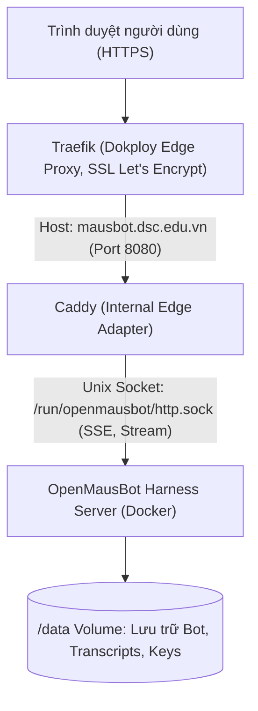

# Kế hoạch Deploy OpenMausBot lên VPS qua Dokploy

- **Ngày lập:** 16/11/2026
- **Trạng thái:** Hoàn tất thành công (Completed)
- **Vị trí lưu:** `docs/plans/2026-11-16-deploy-openmausbot-dokploy.md`
- **Địa chỉ truy cập:** https://mausbot.dsc.edu.vn

---

## 1. Thông tin Triển khai
- **VPS Host:** `217.15.160.118` (SSH root, port 22)
- **Nền tảng Quản lý:** Dokploy (`https://dokploy.dsc.edu.vn`)
- **API Key Dokploy:** `mausbot_appIRIgoFLjKOyUFQslNftsEwCsLpzaMqKQQrYJMLHlsOghKDVtpGqzlnGzmZMmBJet`
- **Tên miền đích:** `mausbot.dsc.edu.vn` (Đã trỏ DNS A Record về `217.15.160.118`)

---

## 2. Kiến trúc Triển khai trên Dokploy (Docker Compose + Traefik)

Hệ thống được đóng gói thành một Docker Compose stack tích hợp hoàn hảo với mạng `dokploy-network` và Traefik Reverse Proxy sẵn có của Dokploy:

### Các dịch vụ trong Stack:
1. **`omb` (OpenMausBot Server):**
   - Image: `ghcr.io/milind-soni/openmausbot:latest`
   - Volume: `mausbot_data:/data` (lưu trữ vĩnh viễn cấu hình bot, chat, keys)
   - Sockets tmpfs: `mausbot_edge:/run/openmausbot`
   - Biến môi trường:
     - `OMB_PORT=8799`
     - `OMB_WEBHOOK_PORT=8800`
     - `OMB_TUNNEL_SOCKET=/run/openmausbot/http.sock`
     - `OMB_WEBHOOK_SOCKET=/run/openmausbot/hooks.sock`
     - `OMB_PUBLIC_URL=https://mausbot.dsc.edu.vn`
     - `OMB_WEBHOOK_PUBLIC_URL=https://mausbot.dsc.edu.vn`
     - `OMB_SERVER_NAME=mausbot.dsc.edu.vn`

2. **`caddy` (Internal Reverse Proxy):**
   - Chuyển tiếp cổng `8080` sang socket `/run/openmausbot/http.sock` với cờ `flush_interval -1` (đảm bảo Server-Sent Events / SSE streaming mượt mà).
   - Gắn nhãn Traefik để Dokploy tự động cấp chứng chỉ SSL Let's Encrypt cho `mausbot.dsc.edu.vn`.

---

## 3. Các bước Thực hiện

1. **Bước 1 (Đã hoàn thành):** Khởi tạo Project `mausbot` và Compose Service `mausbot` trong Dokploy thông qua Dokploy tRPC API.
2. **Bước 2 (Đang thực hiện):** Tải trước Docker Image `ghcr.io/milind-soni/openmausbot:latest` trên VPS.
3. **Bước 3:** Cấu hình file `docker-compose.yml` và inline Caddyfile cho stack trong Dokploy.
4. **Bước 4:** Kích hoạt Deploy qua Dokploy API.
5. **Bước 5:** Xác minh kết nối HTTPS `https://mausbot.dsc.edu.vn` và tạo mã Pairing Code để người dùng kết nối lần đầu.
