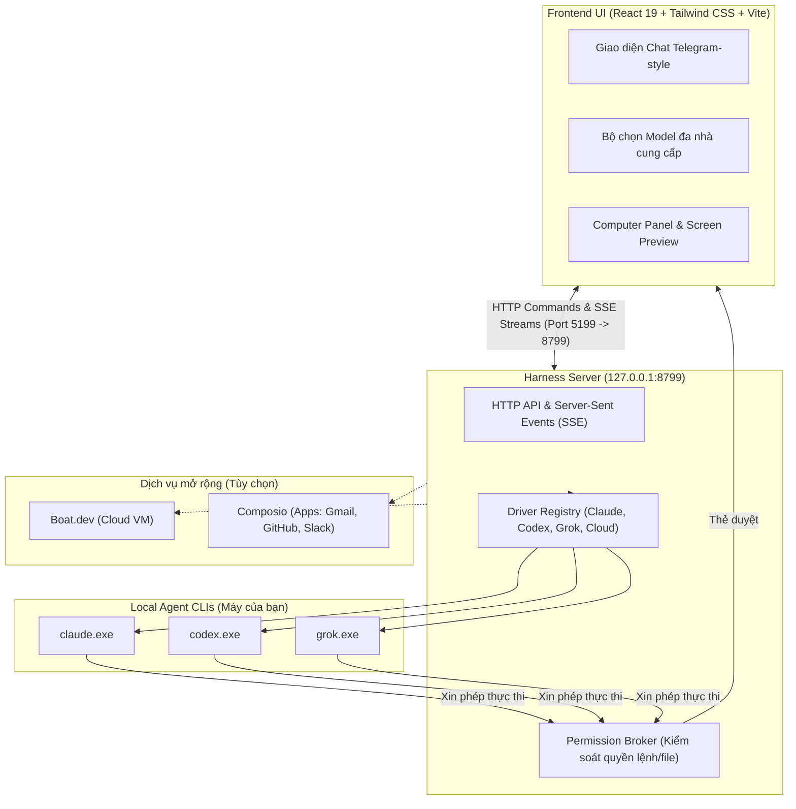

# Kế hoạch Tìm hiểu, Giới thiệu Chi tiết, Cài đặt và Khởi chạy OpenMausBot

- **Ngày lập:** 16/11/2026
- **Trạng thái:** Chờ phê duyệt (Pending Approval)
- **Vị trí lưu:** `docs/plans/2026-11-16-setup-and-run-openmausbot.md`

---

## 1. Giới thiệu Chi tiết về OpenMausBot

### 1.1. OpenMausBot là gì?
**OpenMausBot** (trước đây gọi là *OpenGrokBot*, hay *MausBot*) là phần mềm mã nguồn mở (Apache 2.0) hoạt động như một ứng dụng trò chuyện (chat app giống Telegram/Slack) nơi **mỗi bot trong danh bạ là một AI Agent thực thụ**.
Dự án được tạo ra như một giải pháp mã nguồn mở thay thế cho các nền tảng trợ lý đóng như:
- **xAI Grok Bot**: Roster bot chạy trên cloud VM đóng của xAI.
- **Meta Muse**: Trợ lý cá nhân trong sandbox VM của Meta.
- **OpenAI dots**: Roster trợ lý trả phí bên trong ChatGPT.
- **Cue by Manus**: Nền tảng bot có số điện thoại, ví điện tử đóng.

### 1.2. Triết lý thiết kế cốt lõi
1. **Bring Your Own Agents (BYOA):** Sử dụng trực tiếp các CLI đã đăng nhập trên máy tính của bạn (`claude` của Anthropic, `codex` của OpenAI, `grok` của xAI) — không cần tạo tài khoản trung gian, không chuyển tiếp token qua máy chủ bên thứ ba.
2. **Local-First & Quyền riêng tư:** Một Harness Server nhỏ chạy trên `127.0.0.1:8799` quản lý vòng đời mọi tiến trình agent. Dữ liệu hội thoại, transcripts, khóa cấu hình được lưu cục bộ trong `~/.openmausbot`.
3. **Agents có "đôi tay" (Hands & Computer Use):** Mỗi bot có thể tương tác với:
   - Cloud Linux Desktop (thông qua Boat.dev)
   - Local VM độc lập
   - Hoặc điều khiển máy tính cục bộ (Cua Driver trên Windows & macOS)
   - Kết nối 500+ ứng dụng (Gmail, Slack, GitHub, Linear...) qua Composio OAuth.
4. **Human-in-the-Loop (Approval Cards):** Bất cứ hành động nguy hiểm nào (chạy lệnh shell, sửa file, câu hỏi cần xác nhận) đều hiển thị dưới dạng thẻ tương tác (Allow / Deny) trong khung chat.
5. **Đa giọng nói & Gọi thoại (Voice & Calling):** Hỗ trợ đàm thoại trực tiếp và chuyển văn bản thành giọng nói (ElevenLabs, Fish Audio, Grok xAI Voice, macOS native voice).

### 1.3. Kiến trúc kỹ thuật (Architecture)
Hệ thống gồm 2 thành phần chính:


---

## 2. Đánh giá Môi trường Hiện tại trên Máy Tính

Qua kiểm tra hệ thống của bạn:
- **Hệ điều hành:** Windows 11 (x64)
- **Node.js:** `v24.18.0` (Đạt yêu cầu `node >= 24`, hỗ trợ sẵn native `--experimental-strip-types`)
- **Git:** `git.exe` sẵn sàng
- **pnpm:** `v11.25.0`
- **Agent CLIs sẵn có:**
  - `claude.exe` (`C:\Users\duongsinh\.local\bin\claude.exe`)
  - `codex.exe` (`C:\Users\duongsinh\AppData\Local\Programs\OpenAI\Codex\bin\codex.exe`)
  - `grok.exe` (`C:\Users\duongsinh\.grok\bin\grok.exe`)
- **Trạng thái repo:** Mã nguồn sạch, chưa cài đặt `node_modules`.

> [!IMPORTANT]
> **Vấn đề đã nhận diện & giải pháp:**
> File `package.json` của repo quy định `"packageManager": "pnpm@10.33.0"`, trong khi phiên bản pnpm toàn cục trên máy là `11.25.0`. Theo mặc định, pnpm v11 sẽ cố gắng chuyển đổi phiên bản và bị nghẽn (hang) khi chạy không có TTY.
> **Giải pháp kỹ thuật:** Thêm tham số `--pm-on-fail=ignore` vào các lệnh pnpm (hoặc cập nhật cấu hình pnpm) để pnpm v11 chạy trực tiếp mà không bị treo.

---

## 3. Kế hoạch Thực hiện Cài đặt & Khởi chạy

### Giai đoạn 1: Cài đặt Dependencies
1. Chạy lệnh cài đặt các gói phụ thuộc của toàn bộ monorepo/workspace:
   ```powershell
   cmd.exe /c "pnpm --pm-on-fail=ignore install"
   ```
2. Kiểm tra tính toàn vẹn của thư mục `node_modules`.

### Giai đoạn 2: Cấu hình Môi trường
1. Tạo file `.env` từ `.env.example` nếu chưa có:
   - Các cổng mặc định:
     - Harness Server: `8799`
     - Web UI: `5199`
2. Đảm bảo cổng `8799` và `5199` không bị ứng dụng khác chiếm giữ.

### Giai đoạn 3: Khởi chạy Harness Server
1. Chạy tiến trình server nền:
   ```powershell
   node --experimental-strip-types server/dev-server.ts
   ```
   (hoặc qua script: `cmd.exe /c "pnpm --pm-on-fail=ignore dev:server"`)
2. Kiểm tra phản hồi tại: `http://127.0.0.1:8799/api/health`.

### Giai đoạn 4: Khởi chạy Giao diện Người dùng (Web App UI)
1. Chạy Vite dev server:
   ```powershell
   cmd.exe /c "pnpm --pm-on-fail=ignore dev"
   ```
2. Giao diện người dùng sẽ sẵn sàng tại `http://127.0.0.1:5199`.

### Giai đoạn 5 (Tùy chọn): Khởi chạy Desktop App (Electron)
- Nếu bạn muốn trải nghiệm cửa sổ ứng dụng Windows độc lập (Desktop Electron Shell):
  ```powershell
  cmd.exe /c "pnpm --pm-on-fail=ignore dev:desktop"
  ```

---

## 4. Kế hoạch Kiểm tra & Xác minh (Verification Plan)

### 4.1. Tự động hóa (Automated Checks)
- Kiểm tra TypeScript & build:
  ```powershell
  cmd.exe /c "pnpm --pm-on-fail=ignore typecheck"
  ```
- Kiểm tra endpoint server:
  - `GET http://127.0.0.1:8799/api/health` trả về JSON hợp lệ có status ok.
  - `GET http://127.0.0.1:5199` trả về mã 200 (HTML giao diện).

### 4.2. Thủ công (Manual Verification)
- Mở trình duyệt tại `http://127.0.0.1:5199`.
- Xác nhận danh sách bot xuất hiện trong thanh bên (sidebar).
- Vào **Settings → Engines** để xác nhận 3 agent CLIs (`claude`, `codex`, `grok`) được nhận diện tự động và chuyển sang màu sáng/sẵn sàng.
- Thử gửi một câu hỏi ngắn ("Xin chào") tới một bot để kiểm tra quá trình sinh phản hồi.

---

## 5. Câu hỏi Mở dành cho Bạn (User Review Required)

> [!NOTE]
> Bạn muốn trải nghiệm phần mềm theo cách nào:
> 1. **Khởi chạy phiên bản Web App (Khuyên dùng)**: Nhanh, nhẹ, mở trực tiếp trên trình duyệt Chrome/Edge tại `http://127.0.0.1:5199`.
> 2. **Khởi chạy ứng dụng Desktop (Electron)**: Cửa sổ ứng dụng máy tính độc lập.
