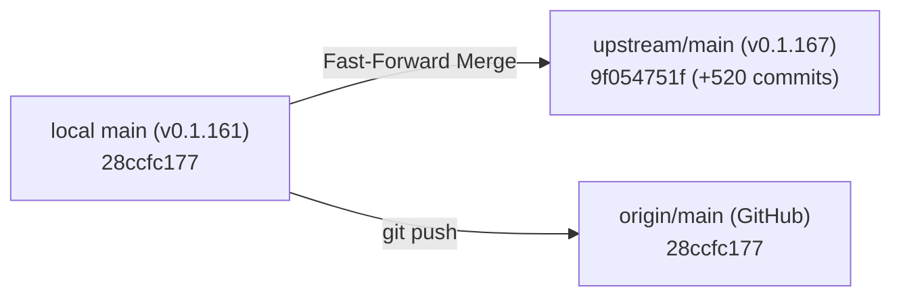

# Kế hoạch Cập nhật & Đồng bộ Repository từ Upstream về Local và GitHub

- **Ngày lập:** 17/11/2026
- **Trạng thái:** Hoàn tất thành công (Completed)
- **Vị trí lưu:** `docs/plans/2026-11-17-sync-upstream-update.md`
- **Phiên bản mới nhất:** v0.1.167 (commit `9f054751f`)

---

## 1. Mục tiêu & Bối cảnh

Repository gốc (`upstream`: `https://github.com/milind-soni/OpenMausBot.git`) đã phát hành phiên bản mới **v0.1.167** (vượt trước 520 commits so với phiên bản hiện tại v0.1.161).

Nhiệm vụ:
1. Đồng bộ toàn bộ 520 commits và các tag phiên bản mới từ `upstream/main` về nhánh `main` ở máy local.
2. Giữ an toàn và nguyên vẹn các file tài liệu kế hoạch trong `docs/plans/` và các scripts triển khai trong `scripts/`.
3. Đẩy (push) các thay đổi và tags mới lên GitHub cá nhân (`origin`: `https://github.com/covuaduongsinh/OpenMausBot.git`).
4. Cập nhật dependencies bằng `pnpm` trên máy local để đảm bảo mã nguồn mới chạy trơn tru.

---

## 2. Phân tích Hiện trạng Git



- **Ancestry Check:** `git merge-base --is-ancestor HEAD upstream/main` trả về **HỢP LỆ** (Fast-Forward 100%, không bị xung đột phân nhánh / merge conflicts).
- **Working Tree:**
  - File `pnpm-workspace.yaml` có 2 dòng thay đổi nháp cần hoàn tác (`core-js`, `workerd`).
  - Các file tài liệu và script mới chưa track:
    - `docs/plans/2026-11-16-setup-and-run-openmausbot.md`
    - `docs/plans/2026-11-16-deploy-openmausbot-dokploy.md`
    - `scripts/dokploy-api.mjs`
    - `scripts/update-dokploy-mausbot.mjs`
    (Các file này không trùng lặp với upstream và hoàn toàn an toàn).

---

## 3. Kế hoạch Triển khai Chi tiết

### Bước 1: Dọn sạch Working Tree
- Hoàn tác thay đổi cục bộ ở `pnpm-workspace.yaml` bằng `git checkout -- pnpm-workspace.yaml`.
- Đảm bảo các file trong `docs/plans/` và `scripts/` giữ nguyên trạng thái.

### Bước 2: Đồng bộ nhánh Main từ Upstream
- Chạy lệnh Fast-forward:
  ```bash
  git merge --ff-only upstream/main
  ```
- Kiểm tra `git log -n 5 --oneline` để xác nhận commit head là `9f054751f` (v0.1.167).

### Bước 3: Cập nhật dependencies ở Local
- Chạy cập nhật package:
  ```bash
  pnpm install --pm-on-fail=ignore
  ```
- Kiểm tra tính toàn vẹn cú pháp / static check:
  ```bash
  pnpm run check:types  # hoặc kiểm tra nhanh node scripts/check-model-manifest.mjs
  ```

### Bước 4: Đồng bộ lên GitHub (`origin`)
- Đẩy nhánh `main` mới nhất lên GitHub:
  ```bash
  git push origin main
  ```
- Đẩy các git tags mới (`v0.1.165`, `v0.1.166`, `v0.1.167`...) lên GitHub:
  ```bash
  git push origin --tags
  ```

### Bước 5: Cập nhật Dokploy VPS (Đã hoàn tất)
- Đã kéo bản build Docker Image mới nhất (`ghcr.io/milind-soni/openmausbot:latest`) về máy chủ VPS `217.15.160.118`.
- Recreate container `omb` và `caddy` trơn tru.
- Chạy `openmausbot doctor` xác nhận:
  - Trạng thái: `ready`
  - Phiên bản máy chủ: `v0.1.166` (được nâng từ `v0.1.161`)
  - Endpoint `https://mausbot.dsc.edu.vn/api/health` trả về `{"app":"openmausbot"}` (200 OK)
  - Toàn bộ dữ liệu bot, phiên chat và cài đặt trong `/data` volume được giữ nguyên an toàn.

---

## 4. Kế hoạch Kiểm thử & Xác minh (Verification Plan)

1. **Kiểm tra Git Log:** Xác nhận `HEAD` trỏ đúng vào `upstream/main` và `origin/main` cùng commit hash.
2. **Kiểm tra trạng thái Remote:** `git status` báo `Your branch is up to date with 'origin/main'`.
3. **Kiểm tra Version:** Đọc `package.json` xác nhận phiên bản hiển thị là `0.1.167`.
4. **Kiểm tra GitHub:** Truy cập `https://github.com/covuaduongsinh/OpenMausBot` xác nhận commit mới nhất và tags đã xuất hiện.
