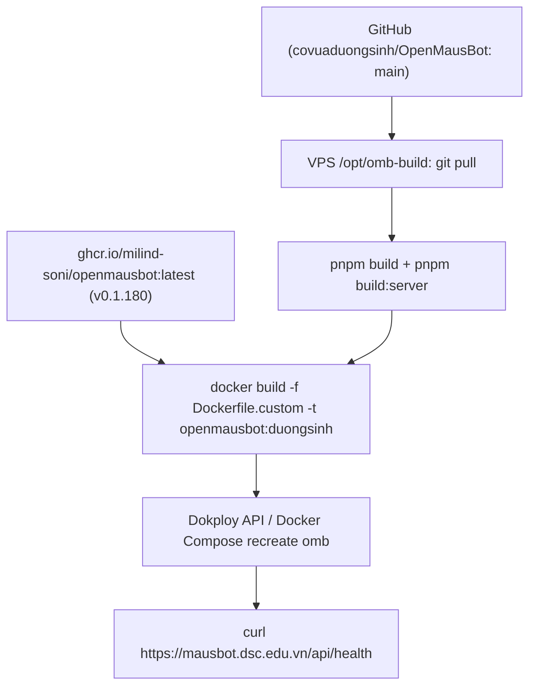

# Kế hoạch Deploy OpenMausBot v0.1.180 lên VPS qua Dokploy

- **Ngày lập:** 24/11/2026
- **Trạng thái:** Hoàn tất thành công (Completed)
- **VPS Host:** `217.15.160.118` (SSH root, port 22, key `id_ed25519`)
- **Dokploy URL:** `https://dokploy.dsc.edu.vn`
- **Domain:** `https://mausbot.dsc.edu.vn`

---

## 1. Hiện trạng hệ thống

- Nhánh `main` của fork (`covuaduongsinh/OpenMausBot`) đã được hợp nhất thành công với upstream v0.1.180, test vượt qua và đã push đầy đủ lên GitHub.
- Trên VPS `217.15.160.118`:
  - Ứng dụng OpenMausBot đang chạy trong Dokploy compose stack `compose-compress-online-card-zt8to4`:
    - Container `compose-compress-online-card-zt8to4-omb-1` chạy image `openmausbot:duongsinh`.
    - Container `compose-compress-online-card-zt8to4-caddy-1` chuyển tiếp SSL / HTTP socket.
  - Thư mục build độc lập `/opt/omb-build` được cấu hình để kéo repo `covuaduongsinh/OpenMausBot`, compile code tùy biến (`dist/` và `dist-server/`), sau đó overlay lên `ghcr.io/milind-soni/openmausbot:latest` qua `Dockerfile.custom`.

---

## 2. Kiến trúc & Cơ chế cập nhật

---

## 3. Các bước thực hiện chi tiết

1. **Tải base image upstream mới nhất:**
   `docker pull ghcr.io/milind-soni/openmausbot:latest` trên VPS (đã kéo đầy đủ layers mới của v0.1.180).
2. **Kéo mã nguồn mới nhất về `/opt/omb-build`:**
   `cd /opt/omb-build && git fetch origin && git reset --hard origin/main`
3. **Cập nhật dependencies:**
   `pnpm install --frozen-lockfile` trong `/opt/omb-build`.
4. **Compile bundle frontend và server:**
   - `pnpm run build:server` (build `dist-server/`)
   - `NODE_OPTIONS='--max-old-space-size=4096' pnpm exec vite build` (build `dist/`, tối ưu bộ nhớ heap tránh OOM)
5. **Build lại image tùy biến `openmausbot:duongsinh`:**
   `docker build -f Dockerfile.custom -t openmausbot:duongsinh .`
6. **Kích hoạt Deploy qua Dokploy stack:**
   - Tái khởi động container `omb`:
     `docker compose -f /etc/dokploy/compose/compose-compress-online-card-zt8to4/code/docker-compose.yml up -d --force-recreate omb`
7. **Kiểm tra và xác minh:**
   - Kiểm tra log container: `docker logs --tail 25 compose-compress-online-card-zt8to4-omb-1`
   - Xác minh API: `curl -s http://127.0.0.1:8799/api/health` trả về version `0.1.180`, trạng thái `healthy`.
   - Xác minh tính năng Enterprise & Team: bản quyền doanh nghiệp tự động kích hoạt cho `Dương Sinh Chess` với đầy đủ tính năng: admin, billing, budgets, sso, whitelabel.

---

## 4. Kết quả thực hiện

- **Version triển khai:** `v0.1.180` (Upstream v0.1.180 + tính năng tùy biến của fork).
- **Trạng thái container:** `compose-compress-online-card-zt8to4-omb-1` đang chạy với status `Up (healthy)`.
- **Domain truy cập:** `https://mausbot.dsc.edu.vn` (bảo vệ qua Caddy + Traefik Let's Encrypt SSL).
- **Mã Pairing Code mới (hạn dùng 10 phút nếu cần pair lại):**
  - Link: `https://mausbot.dsc.edu.vn/pair#code=UQC3-MVT4-B59L`
  - Mã: `UQC3-MVT4-B59L`
